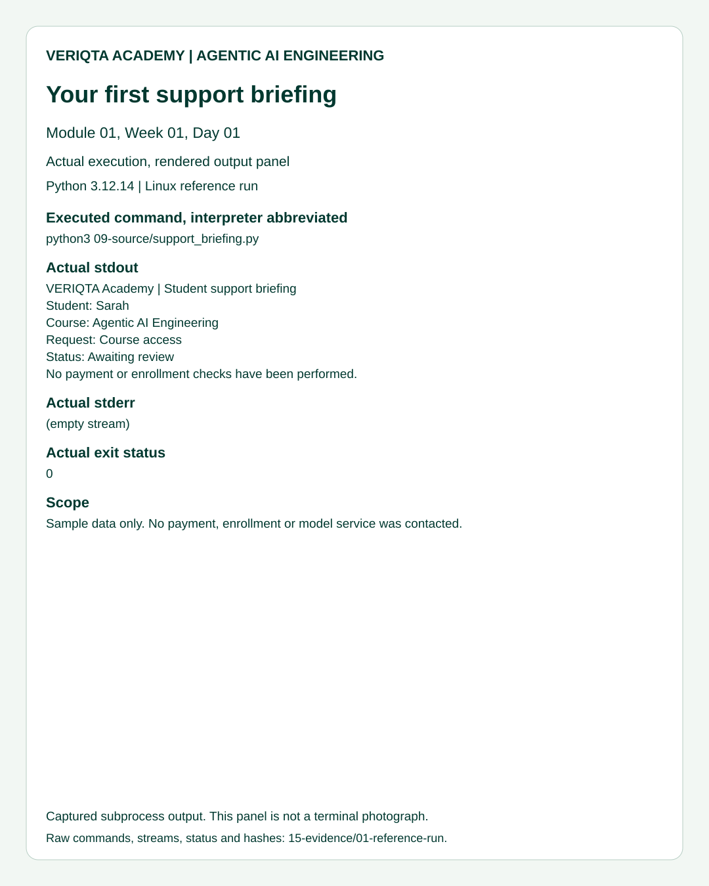
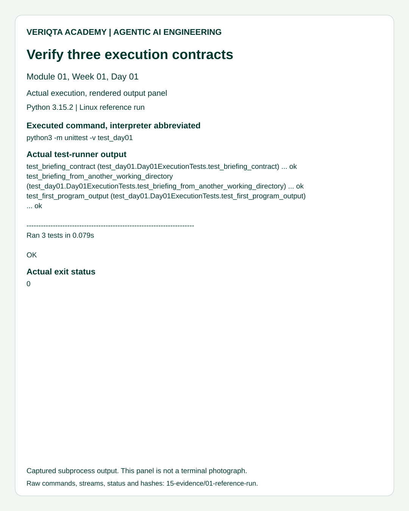
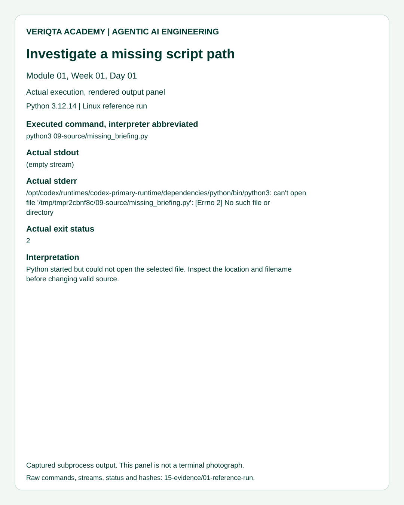
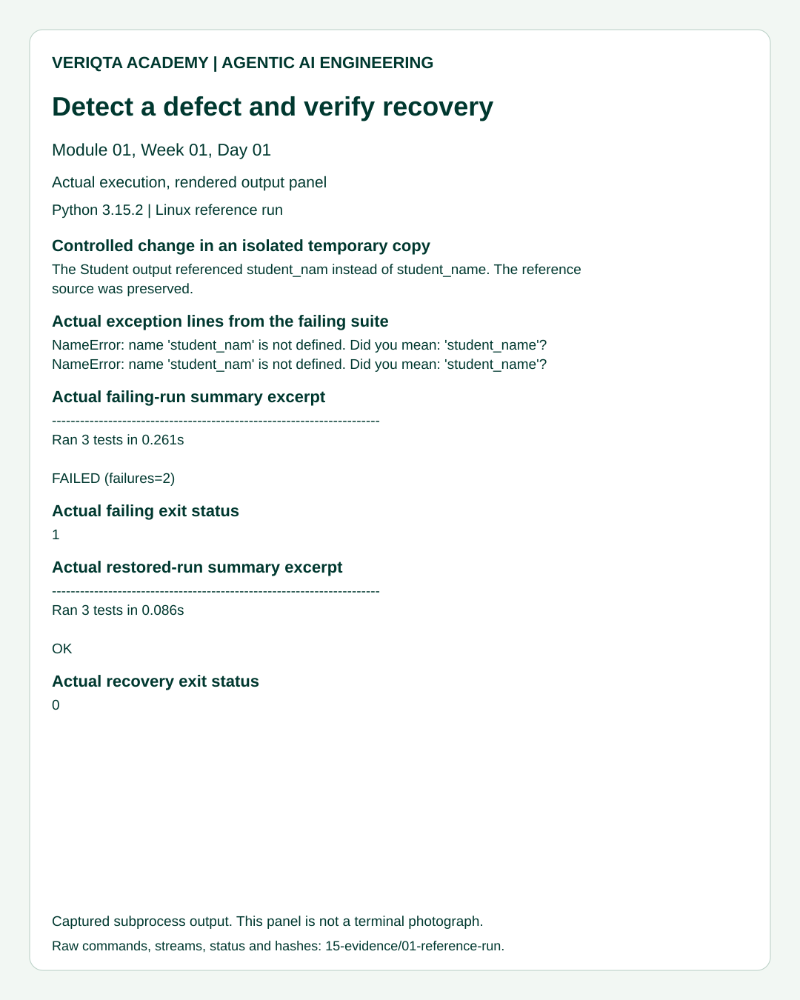

# 14. Actual Reference Output

These panels display results captured from genuine reference executions. They are SVG renderings of output, not photographs of a terminal and not evidence that you personally completed the class. Commands abbreviate the interpreter as python3; raw records retain the actual executable. Error paths and timings can differ in your environment.

## Support briefing

Compare the six fields, the limitation sentence and the successful process status with your own run.

## Automated verification

Compare the discovered method count and result. A zero-test run is not equivalent to this three-method check.

## Path investigation

This deliberate failure selected a nonexistent script. It demonstrates a path boundary, not a defective print statement.

## Controlled regression and recovery

This panel shows labeled excerpts from a failing suite after an undefined variable was introduced in a temporary copy, followed by a passing suite after restoration. Full output remains available in the raw records.

Read the [reference evidence](../15-evidence/README.md) for environment, commands, source hashes, raw output and reproduction instructions. If you share your own screenshot, capture genuine execution and remove credentials, host addresses and unnecessary personal information.
