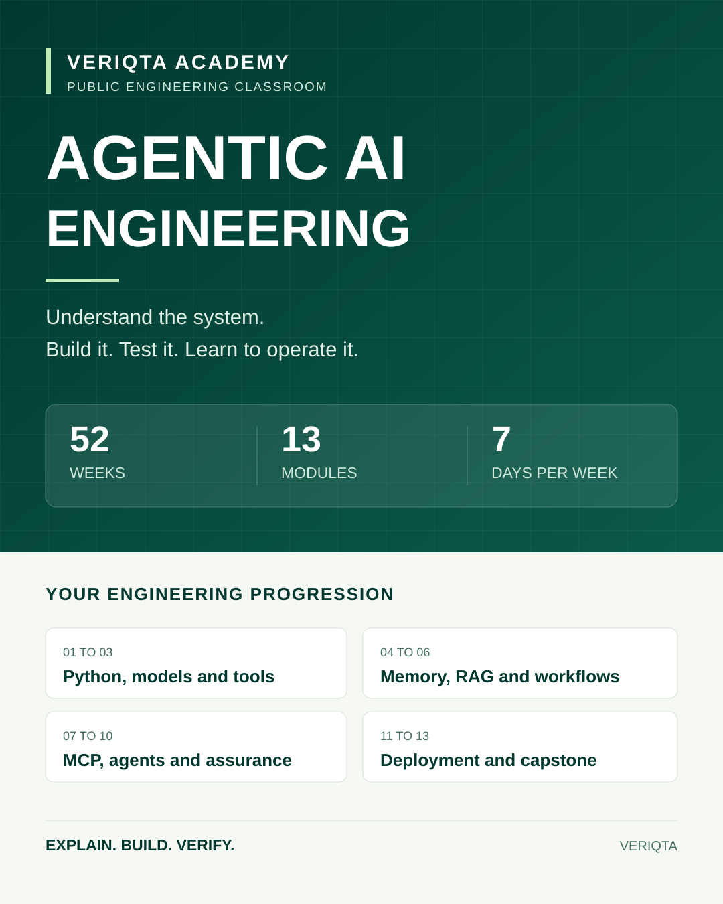

    

<h1 align="center">Agentic AI Engineering</h1>

<strong>Learn by building. Verify with evidence. Engineer for production.</strong>

An open, project-based learning journey by VERIQTA.

## Start your engineering course

You will learn to build, explain, test and improve AI systems through a 52-week course with 13 modules. Begin with ordinary software that behaves predictably, then add models, tools, retrieval, orchestration and production operations. The curriculum develops engineering skills progressively; a course cannot substitute for years of professional operating experience.

1. Read the [classroom blueprint](docs/01-CLASSROOM-BLUEPRINT.md) for the course structure and assessment method.
2. Review the [52-week roadmap](ROADMAP.md) and [learning guide](docs/LEARNING-GUIDE.md).
3. Open [Module 01](modules/module-01/README.md), then [Week 01](modules/module-01/01-week-01/README.md).
4. Start [Lesson 01: Your first program](modules/module-01/01-week-01/01-lessons/01-first-program/README.md). Each lesson explains its commands and code before you execute them.
5. Build the [weekly Student Support Response Toolkit](modules/module-01/01-week-01/02-weekly-project/README.md) as you complete the six milestones.

The [course availability record](docs/PROGRESS.md) distinguishes published teaching materials from planned content. Your own learning progress depends on execution, understanding and practical assessment. A passing reference suite does not complete your week or module.

## What you will learn

**Foundations:** Python, HTTP APIs, testing, Git, LLMs and tool calling.
**Agent systems:** Tools, state, memory, RAG, orchestration, MCP, multi-agent coordination.
**Production engineering:** Threat modeling, evaluations, tracing, deployment, CI/CD, reliability and cost controls.

## Curriculum

| Module | Schedule | Subject | Portfolio milestone |
|---|---|---|---|
| 01 | Weeks 1–4 | [Python & Software Engineering for AI](modules/module-01/README.md) | Student Support Automation Toolkit |
| 02 | Weeks 5–8 | [LLMs & Agent Fundamentals](modules/module-02/README.md) | LLM Support Agent |
| 03 | Weeks 9–12 | [Tools & API Integration](modules/module-03/README.md) | Operations Tool Agent |
| 04 | Weeks 13–16 | [Memory, State & Context](modules/module-04/README.md) | Stateful Learning Assistant |
| 05 | Weeks 17–20 | [RAG & Knowledge Engineering](modules/module-05/README.md) | Document Intelligence Agent |
| 06 | Weeks 21–24 | [Agent Orchestration](modules/module-06/README.md) | Workflow Orchestrator |
| 07 | Weeks 25–28 | [MCP & Interoperability](modules/module-07/README.md) | Custom MCP Integration |
| 08 | Weeks 29–32 | [Multi-Agent Systems](modules/module-08/README.md) | Research and Review Team |
| 09 | Weeks 33–36 | [Security & Governance](modules/module-09/README.md) | Hardened Agent |
| 10 | Weeks 37–40 | [Evaluation & Observability](modules/module-10/README.md) | Agent Quality Dashboard |
| 11 | Weeks 41–44 | [Deployment & AgentOps](modules/module-11/README.md) | Deployed Agent Service |
| 12 | Weeks 45–48 | [Advanced Agentic Systems](modules/module-12/README.md) | Supervised Operations Agent |
| 13 | Weeks 49–52 | [Capstone & Portfolio](modules/module-13/README.md) | Agentic AI Platform |

## Project-first learning standard

Every lesson contains **README, teaching notes, a reproducible lab, source code, tests, exercises, troubleshooting, project documentation and an assessment**. Reference visuals show authentic captured output and link to raw records. You produce your own execution evidence during the labs. Each four-week module concludes with a larger portfolio milestone.

## Technology map

| Layer | Tools and concepts |
|---|---|
| Development | Python, uv/pip, pytest, Git, GitHub |
| Model integration | LLM APIs, structured outputs, tool/function calling |
| Agent orchestration | Framework-independent loops, OpenAI Agents SDK, LangGraph |
| Retrieval | Embeddings, FAISS, Chroma, vector and hybrid search |
| Interoperability | Model Context Protocol (MCP) |
| Applications | FastAPI, REST, async jobs, persistence |
| Delivery | Docker, AWS, GitHub Actions |
| Operations | Logging, tracing, evaluations, metrics, security reviews |

Tools are examples, not permanent dependencies. Lessons pin tested versions and explain alternatives.

## Repository navigation

- [Roadmap](ROADMAP.md)
- [Publication status](docs/PROGRESS.md)
- [Classroom learning guide](docs/LEARNING-GUIDE.md)
- [Environment setup](docs/SETUP.md)
- [Project rubric](docs/PROJECT-STANDARDS.md)
- [Screenshot and evidence rules](docs/EVIDENCE-STANDARDS.md)
- [Security policy](SECURITY.md)
- [Contribution guide](CONTRIBUTING.md)
- [License](LICENSE)

## How to contribute

Corrections, accessible explanations, tests, and reproducibility improvements are welcome. Read [CONTRIBUTING.md](CONTRIBUTING.md). Do not submit fabricated results or live secrets.

## About VERIQTA

VERIQTA creates practical technical learning resources. This repository is an educational classroom and portfolio; any external service or tool mentioned remains the property of its respective owner.

