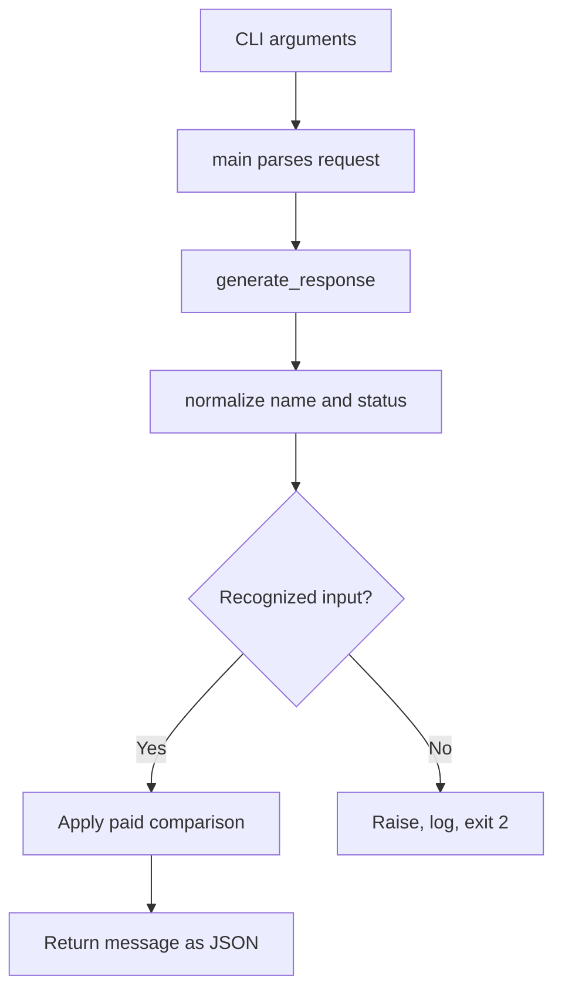

# 01. Project Requirements and Architecture

## Your problem

You need a repeatable answer to course-access requests without accepting malformed data or hiding errors. A support desk analogy separates receiving information, checking it, applying policy and preparing a reply. Your functions implement those responsibilities explicitly.

## Requirements

Accept a nonempty text name. Accept paid, unpaid, pending or refunded after permitted whitespace and case normalization. Reject unsupported labels and non-text direct-function input. Produce valid JSON on stdout for recognized outcomes. Put diagnostics on stderr. Exit 0 for successful processing and 2 for invalid requests. Test core functions and the full CLI.

## Data flow

A missing required flag is rejected by argparse. An invalid name can fail before the payment comparison. You should trace these paths separately rather than assume every failure occurs in the same place.

## File responsibilities

03-source/student_support.py contains validation, policy, response and CLI functions. 04-tests/test_student_support.py imports the helpers and starts subprocess checks. 06-evidence/reproduce_evidence.py captures reference results in an isolated copy. The evidence tool is an optional portfolio aid after you understand the application, not a prerequisite for learning a first function.

## Design choices

Core functions return values so you can reuse them from tests or a future API. The CLI handles argument parsing and process output. Validation distinguishes a recognized negative decision from unknown data. Normalization is deliberate per-field policy. Separate stdout/stderr preserves a machine-readable response. Conventional source names support normal Python imports.

## Trust and reliability

Do not use a supplied paid label as evidence for real access. A later integration must authenticate and authorize requests and obtain authoritative transaction data matched to the correct student and course. No current test proves those future controls. Do not introduce credentials or production access changes into this simulation.
