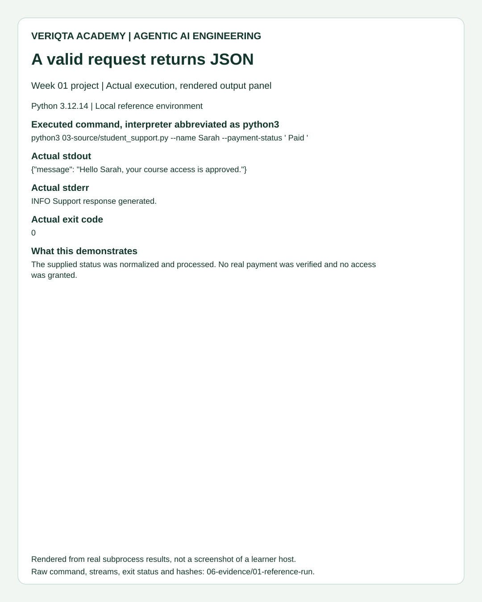
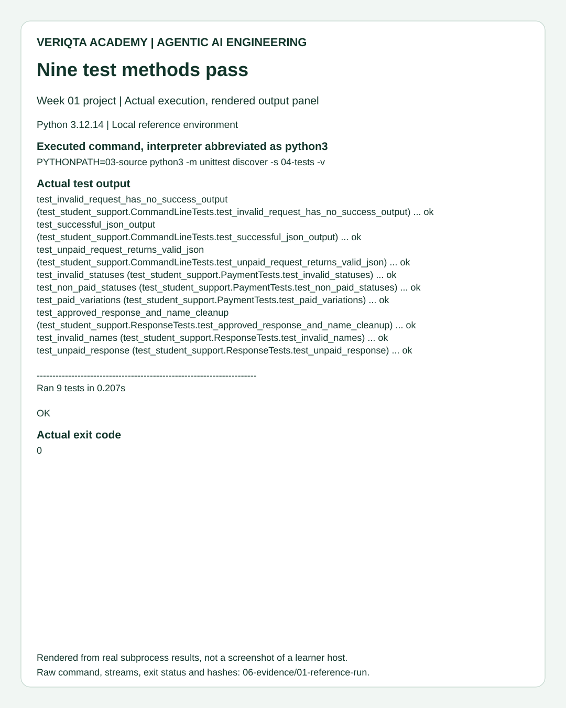
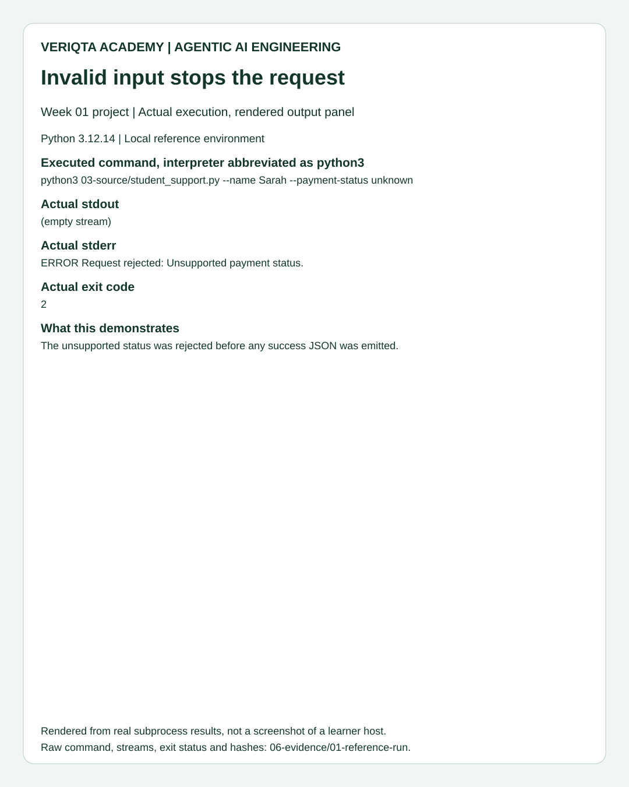
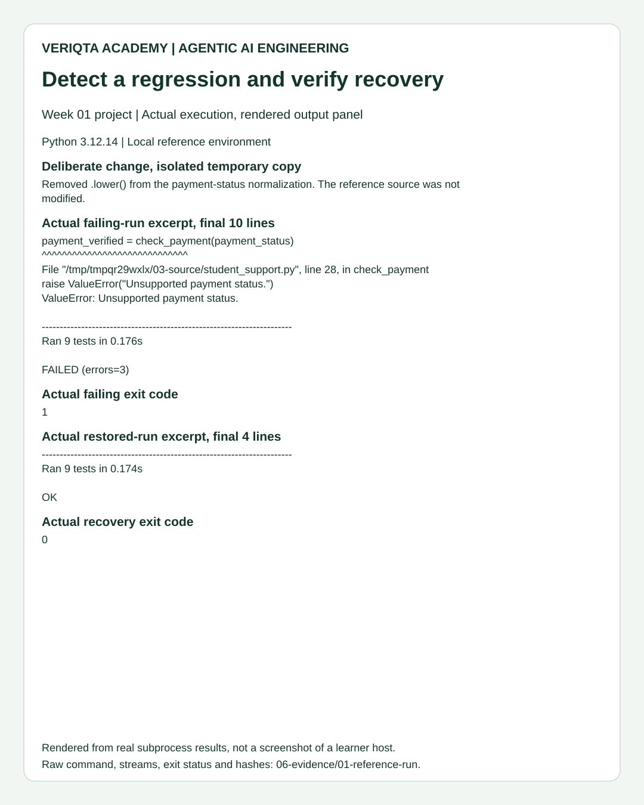

# 05. Compare Actual Reference Output

These panels display output captured from genuine subprocess runs. They are labeled SVG renderings, not screenshots of a learner's computer. Compare the command, streams and exit status with your own result. The interpreter label is abbreviated as python3; raw records retain the actual executable.

## A valid request

## The nine-method suite

## Rejected input

## Regression and recovery

Use the [raw records and reproduction instructions](../06-evidence/README.md) to inspect provenance. Runtime values and temporary paths will differ. These results verify the reference implementation's defined behavior, not real payment verification or your personal assessment.
