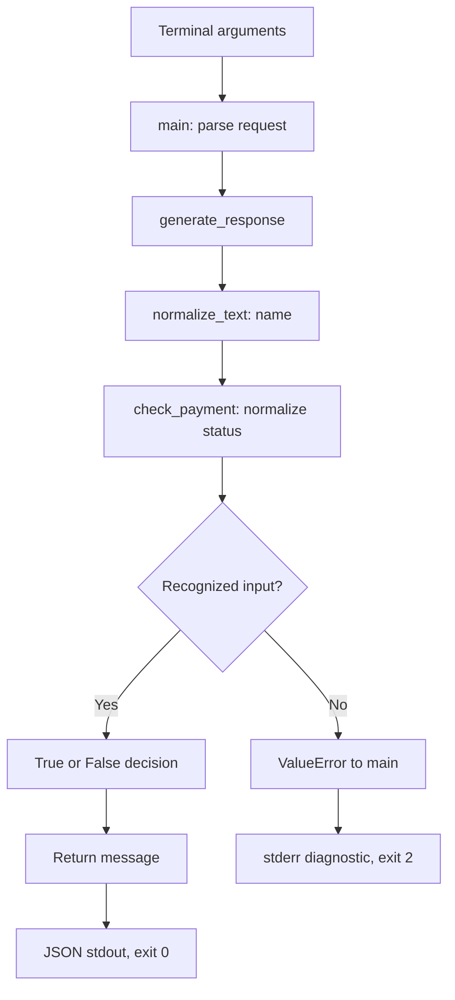

# 02. Comprehensive Teaching Notes

## 1. What is being built, and why start here?

VERIQTA Academy receives a request from Sarah about course access. The first engineering challenge is not generating attractive language. It is deciding whether the data is usable, applying a predictable rule and communicating the outcome without hiding failures.

A language model can produce persuasive words even when its facts are wrong. A dependable agent therefore needs tools and ordinary application code with explicit behavior. This lesson builds one such foundation. It does not add an LLM simply to justify the course title. Later agents can call tested functions instead of inventing payment decisions in free text.

The application accepts a name and simulated payment status. A recognized paid status produces an approval message. Recognized non-paid statuses produce a verification message. Unsupported or malformed values stop processing. The distinction between those outcomes is the core engineering lesson.

## 2. The support-desk analogy and its limits

Imagine a receptionist, payment desk and support representative. The receptionist checks the information, the payment desk applies policy, and the representative composes a response. In software, normalize_text checks and cleans text, check_payment interprets a status, and generate_response prepares the message. main coordinates the work.

There is no web form in this application. The terminal supplies values. A form is a familiar way to picture incoming data; it is not a hidden feature. Likewise, the payment desk is an analogy: this code never contacts a bank or provider. An explanation should help readers see the implementation, not suggest capabilities that do not exist.

## Architecture map before the code

Invalid names can raise before the payment step. Missing arguments are rejected by the parser. Follow one complete path before studying the implementation; this map shows responsibilities, not real payment verification.

## 3. Computer, operating system, terminal and shell

The computer provides processor, memory and storage. Ubuntu is an operating system that manages these resources and runs programs. A terminal displays text interaction. A shell reads commands typed into that terminal and starts programs.

When a reader types a Python command, the shell first separates its words and handles quoted arguments or redirection. It then starts the Python interpreter with the supplied arguments. Python reads the script, defines functions and executes top-level statements. The operating system reports the process's final exit code to the shell.

An SSH application on a laptop may show a remote Ubuntu shell. That does not make the remote program run on the laptop. The program runs where the shell session points. Public readers can work locally on Linux; remote cloud use is optional. Never assume a screenshot proves a publisher can access that remote host.

## 4. Files, directories and the current location

A directory groups files. A path tells software where a file lives. An absolute path starts from the filesystem root. A relative path is interpreted from the current working directory. `16-source/01_student_support.py` means that file under the lesson directory only when the shell is currently in the lesson directory.

`pwd` prints the current working directory. `cd` changes it. `ls` lists entries. These commands help diagnose paths rather than serving as rituals to memorize. A file-not-found error often means the script exists but the caller selected the wrong directory.

The repository is the version-controlled classroom. A reader's working project is where practice happens. Keep experiments or evidence separate from the reference files when possible. Git records changes to tracked text; an editor saves a file to disk. Saving in vi does not itself create a Git commit or push a branch.

## 5. Programs, scripts and the interpreter

A program is instructions and data that a computer executes. A Python script is a text file containing Python source. The interpreter reads and runs it. The `.py` extension identifies its intended language but does not make the file execute automatically.

In `python3 16-source/01_student_support.py`, python3 is the executable and the following path identifies the script. Additional words are passed to the application. This is different from entering Python statements directly into a shell, which does not understand Python syntax.

A comment beginning with `#` explains code to humans. A module docstring, written as a string at the start of a file, documents the module. Neither verifies the application. Names such as first_agent.py are historical labels; a print statement is not an autonomous agent.

## 6. Values, types and variables

A value is information the program works with. `"Sarah"` is a string, `123` is an integer, True and False are Booleans, and None represents absence of a value. Quotes make something a string. `"123"` and `123` have different types even though their written digits look alike.

A variable is a name bound to a value. In `student_name = "Sarah"`, the assignment operator `=` binds the name student_name to the string. It does not ask a question. In `status == "paid"`, the comparison operator `==` asks whether values are equal and produces a Boolean.

Descriptive names explain intent. student_name identifies incoming data, cleaned identifies a normalized string, and payment_verified identifies a Boolean decision. Naming is not evidence: despite that variable name, the current application verifies only a supplied status against a rule, not a real payment.

Python names are case-sensitive. True is the Boolean literal; true would be an ordinary name and usually fail if not defined. Strings are also case-sensitive until a program deliberately normalizes them.

## 7. Strings, methods and normalization

A string is a sequence of text characters. A method is an operation available on an object. In `value.strip()`, the dot accesses the string's strip method and parentheses call it. With no argument, strip removes whitespace from both ends. It does not remove internal spaces or all punctuation.

Strings are immutable. strip returns a string result; it does not edit the existing string in place. `cleaned = value.strip()` stores that result under cleaned. `lower()` returns lowercase text. The application chains them by calling normalization first and lower afterward.

Normalization is an explicit interpretation rule, not a universal cleanup step. Outside spaces and capitalization are harmless variations for these payment labels. Passwords, identifiers or provider signatures may require exact matching; automatically lowercasing them could break security. Names preserve capitalization to avoid changing their presentation unnecessarily.

Validation checks whether input meets a contract. Normalization creates a standard representation where the contract permits it. These responsibilities are related but different. Removing spaces does not make a false payment statement trustworthy.

## 8. Functions, parameters and arguments

A function defines reusable work. `def normalize_text(value, field_name):` defines its name and parameter names. The colon introduces an indented body. Four spaces are used consistently in this classroom. Indentation changes program structure; it is not decorative alignment.

Parameters are local names for incoming values. Arguments are the values supplied by a call. In `normalize_text("  Sarah  ", "student_name")`, value receives the spaced name and field_name receives the ordinary string label student_name. The label helps format an error; it does not refer indirectly to another variable.

The caller and function can use different variable names. `name = normalize_text(student_name, "student_name")` passes the value stored in student_name, receives the function result and stores it as name. Inside the helper, the same incoming information is called value and its cleaned result is called cleaned.

Each function call has its own local context. A cleaned variable in normalize_text is not automatically a global variable in main. Data crosses these boundaries through arguments and returned values. This is why tracing values is more useful than memorizing every name.

## 9. Return versus print

`return cleaned` ends the current function call and gives a value to the caller. It does not print anything. The caller can store it, compare it, serialize it or pass it onward. Once a return executes, later lines in that same call do not run.

`print(message)` writes output, usually to stdout. A function that only prints is harder for another program to reuse because the caller receives no meaningful message value unless it captures output. Keeping core functions return-based lets tests directly compare results and lets a later API adapter reuse the logic.

Returning a result is like a receptionist handing a checked record to the next desk. Printing is like displaying it on a notice board. Both can be useful, but they solve different problems. This application prints only at the outer command-line boundary.

## 10. Conditions and truth values

An if statement selects work when its condition is true. `if not isinstance(value, str):` selects rejection for non-text input. isinstance asks whether the value has the expected type; not reverses that Boolean result.

After trimming, `if not cleaned:` checks emptiness. An empty string is falsey and a nonempty string is truthy. A spaces-only string is initially nonempty, but strip turns it into an empty string. That is why checking type alone is insufficient.

`if payment_verified:` uses a Boolean returned by check_payment. If True, generate_response returns the approval message. If False, execution reaches the later return. An else is unnecessary after an unconditional return because the first branch already ended the function.

## 11. Sets and an explicit status contract

`VALID_STATUSES = {"paid", "unpaid", "pending", "refunded"}` creates a set. A set stores distinct members and supports membership tests. The uppercase variable name signals a shared constant by convention; Python does not prevent a programmer from changing it.

`status not in VALID_STATUSES` asks whether the status is outside the recognized set. The application does not guess a meaning for unknown labels. Accepted labels are a contract between the source and this component. Provider-specific labels would need an explicit mapping during integration.

Paid produces True. Unpaid, pending and refunded produce False. Unknown raises ValueError. A valid negative decision is not the same as invalid information. Confusing them can conceal upstream data defects or accidentally authorize actions.

## 12. Exceptions and controlled failure

An exception signals that normal processing cannot continue in the usual way. `raise ValueError(...)` deliberately reports an invalid input. This is preferable to allowing a non-string to fail accidentally when strip is called, because the caller gets a predictable failure category.

If normalize_text raises, Python stops that call. It also stops the enclosing check_payment or generate_response call unless a handler catches the exception. The exception travels back through callers to the try/except in main. Returning False would not do this; False is an ordinary result.

Main catches only ValueError because this is the expected invalid-input contract. A broad catch-all could hide programming errors, making an apparently calm application silently wrong. Unexpected failures should remain diagnosable. Future network integration will add separate timeout and provider-error handling rather than pretending all failures are invalid student data.

## 13. Command-line interfaces and argparse

A command-line interface accepts arguments through the terminal. argparse defines their names, reads them and produces useful usage errors. Both name and payment-status are required. Missing a required option is rejected before the main validation try block.

The terminal flag uses `--payment-status` while Python accesses `args.payment_status`. argparse translates the hyphen to an underscore for the attribute name. `--help` describes the interface and exits without processing a support request.

Quotes preserve multiple words or outside spaces as one argument. They are shell syntax and are not part of the final string supplied to the application. Avoid using real secrets as command-line arguments, because shell history or process inspection may expose them.

## 14. Dictionaries and JSON

A dictionary maps keys to values. `{"message": message}` uses the literal string message as the key and the variable message as its value. The quotes distinguish the fixed field name from the variable holding the response.

JSON is a text interchange format understood by many languages. `json.dumps` converts the dictionary into JSON text. `json.loads` parses JSON text back into Python data. Dumping and loading are opposite directions; neither verifies that a payment is real.

The response currently contains only a message. A later interface may add a structured decision code, but its meaning and tests must be defined before implementation. Do not parse approval by searching for reassuring words in model-generated language.

## 15. Logs, stdout, stderr and exit status

A process normally has separate standard output and standard error streams. Successful application data goes to stdout. Diagnostics go to stderr. Both appear in an interactive terminal, but callers can capture them separately. Mixing log lines into a JSON document can break another program's parser.

The logger is obtained with logging.getLogger(__name__). main configures INFO-level reporting with a level and message. The log avoids student names and raw input. This reduces unnecessary data exposure while recording that a request succeeded or failed validation.

An exit status is a number reported when a process finishes. This application uses 0 for successful processing and 2 for invalid requests. Unpaid can legitimately exit 0 because the request was valid and processed correctly. Business approval and software execution success answer different questions.

`raise SystemExit(main())` converts main's returned integer into process exit status. Merely writing return 2 in a helper would not necessarily cause an operating-system exit unless the caller uses it appropriately.

## 16. Imports and the execution guard

Imports load reusable functionality. argparse, json, logging, unittest, subprocess, pathlib, sys and runpy are standard-library modules. No pip package is required. The standard library is included with a normal Python installation, although distribution packaging can vary for some optional components.

When Python runs a script directly, its __name__ is __main__. When a tool loads it under another name, the value differs. The final guard starts main only in direct script execution. That allows tests to load functions without requesting terminal arguments or printing a support message.

Because this classroom numbers script filenames, the tests use runpy.run_path to load the source into a dictionary. That is a classroom navigation adaptation, explained fully in the testing guide. The guard prevents main from executing during that load. Later package layouts can use conventional imports while retaining numbered learning documents.

## 17. Automated tests as engineering evidence

A test states an expected behavior and checks actual behavior. Function tests call helpers directly. CLI tests start a separate process, capture stdout/stderr and inspect exit status. These levels can catch different defects: a correct function can still be wired incorrectly at the terminal boundary.

Assertions express acceptance criteria. assertTrue checks a true result; assertFalse checks a false result; assertEqual compares values; assertRaises expects an exception. subTest identifies cases inside one loop, keeping capitalization and whitespace examples together rather than creating many repetitive manual exercises.

Passing tests prove only the checked behavior for those inputs and environments. They do not prove all possible inputs, security, scalability or understanding. Test quality matters: an expectation copied from an incorrect implementation can preserve a bug. Define the business requirement before accepting an AI-written test.

## 18. Subprocesses and paths in tests

subprocess.run starts another program and waits for it. The argument list contains the Python executable, application path and separate flags/values. No shell is requested, so these arguments are not treated as shell commands. sys.executable selects the interpreter running the suite.

capture_output=True captures stdout and stderr separately. text=True returns strings. check=False permits the test to inspect nonzero exit codes intentionally. Otherwise, raising on every nonzero code could interrupt a test designed to prove a controlled failure.

Path(__file__) identifies the test file. resolve creates its absolute path; parents[1] selects the lesson directory from a file within 17-tests. Joining the numbered source directory and filename locates the application without relying on the caller's current directory for that subprocess path.

## 19. Reviewing AI-generated software

Read generated code before running it. Identify what it reads, writes, starts or contacts. Inspect dependencies, subprocess invocation, credentials, exception handling and approval boundaries. Ask where each input comes from and what happens when it is missing, wrong or malicious.

Then review tests against requirements. Do they distinguish unsupported input from a negative business result? Do they verify stdout remains machine-readable? Do they cover failure paths? Does a change add a dependency or network call without explanation?

AI can accelerate drafting, but the engineer owns the decision to accept the code. Reproduce failures, inspect diffs and test corrections. Do not rewrite expected test results merely because generated implementation disagrees with them.

## 20. Security and the future agent connection

A supplied label is untrusted information. The present simulator accepts it for learning. A future real access system must authenticate the caller, authorize the operation and query a trusted payment source. It must match transaction state to the correct student and course and required payment details.

A model may read a receipt incorrectly, or the receipt may be unrelated or fabricated. Language confidence is not evidence. The later assessment asks how to handle a conflict between a receipt-reading assistant and a provider record. Keep that question open until the walkthrough and practical reasoning are complete.

The current application does not change access, contact external systems, store personal records, recover a database or deploy a service. Production-oriented learning means making these limits explicit and adding the missing capabilities with tests over time, not attaching a production-ready label to the first successful script.

## 21. From working script to portfolio evidence

A portfolio should show a problem, architecture, implementation, test results, failure investigation and limitations. Screenshots can help readers compare their output, but they must be based on actual execution. A visual rendering of captured output must say how it was produced and preserve its underlying raw text.

Separate expected outputs from actual outputs. Publisher-side reference captures are useful comparison material, not evidence that every reader completed the exercise. Record a reader's own environment and results before assessment. Public documentation should teach the workflow without exposing private conversation details or infrastructure identifiers.

## 22. Reading checkpoint

Before the guided lab, readers should be able to point to the input, validation, decision and output responsibilities. It is acceptable to revisit a specific section. There is no requirement to memorize the implementation. The goal is to predict behavior, explain a failure and make a focused correction with evidence.
