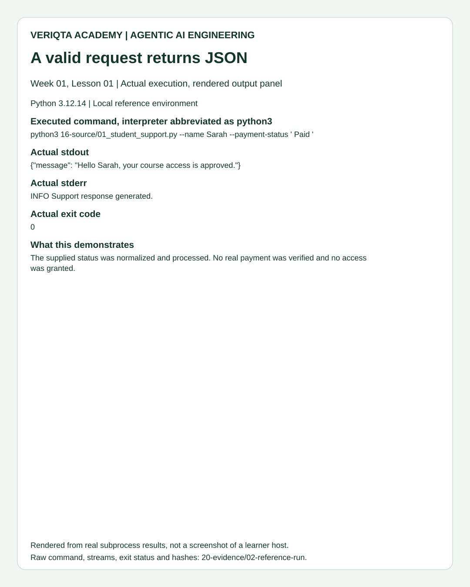
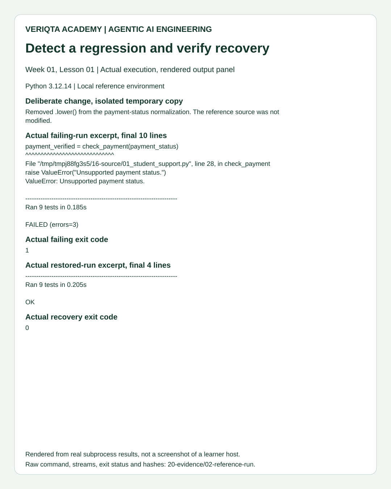

# 07. Weekly Follow-Along Project: VERIQTA Student Support Response Toolkit

## 1. Project brief

Build a reproducible support-response component and demonstrate that it handles valid requests, rejects invalid input and detects a controlled regression. Produce a portfolio evidence bundle that another reader can inspect. This is the Week 01 project increment, developed through lesson milestones. It is not the whole four-week module project.

The project uses the application and tests built in the previous labs. Its additional engineering work is repeatable verification and failure recovery. A portfolio should show how behavior was established, not only a screenshot saying the program worked.

## 2. Requirements and acceptance

- A complete, readable CLI implementation with separated responsibilities.
- Nine meaningful test methods, including CLI success and failure paths.
- Raw environment and execution records without host identifiers.
- A controlled failure in an isolated temporary copy, with the reference files preserved.
- A successful recovery run after restoring the implementation.
- A concise project explanation, known limitations and assessment evidence.

## 3. Architecture of the evidence workflow

The evidence runner creates a temporary practice copy of source and tests. It executes the CLI and suite there, records results, introduces one deliberate regression in that copy, checks that tests detect it, restores the source and verifies recovery. The temporary project is removed afterward. Output evidence remains in a new directory selected by the reader.

This separation protects the classroom reference implementation from the debugging exercise. A timeout prevents a stuck subprocess from blocking indefinitely. The runner refuses an existing evidence directory so a later run cannot silently overwrite earlier results.

## 4. Inspect the runner before execution

Open the [complete evidence runner](20-evidence/01_reproduce_evidence.py). The code is included below so the project is reproducible without guessing missing steps.

```python
"""Capture real execution results without publishing host identifiers."""

import argparse
import hashlib
import json
from pathlib import Path
import platform
import shutil
import subprocess
import sys
import tempfile

LESSON = Path(__file__).resolve().parents[1]
APP = LESSON / "16-source" / "01_student_support.py"
TESTS = LESSON / "17-tests" / "01_test_student_support.py"


def execute(arguments, directory):
    result = subprocess.run(
        arguments, cwd=directory, capture_output=True,
        text=True, check=False, timeout=30,
    )
    return {
        "arguments": arguments,
        "exit_code": result.returncode,
        "stdout": result.stdout,
        "stderr": result.stderr,
    }


def main():
    parser = argparse.ArgumentParser(description=__doc__)
    parser.add_argument("--output", required=True)
    args = parser.parse_args()
    output = Path(args.output).resolve()
    if output.exists():
        parser.error("Choose a new output directory to preserve prior evidence.")
    output.mkdir(parents=True)

    def save(name, value):
        (output / name).write_text(json.dumps(value, indent=2) + "\n")

    save("02-environment.json", {
        "python": platform.python_version(),
        "system": platform.system(),
        "source_sha256": hashlib.sha256(APP.read_bytes()).hexdigest(),
        "tests_sha256": hashlib.sha256(TESTS.read_bytes()).hexdigest(),
    })
    with tempfile.TemporaryDirectory() as temporary:
        root = Path(temporary)
        shutil.copytree(LESSON / "16-source", root / "16-source")
        shutil.copytree(LESSON / "17-tests", root / "17-tests")
        cli = [sys.executable, "16-source/01_student_support.py", "--name", "Sarah"]
        suite = [sys.executable, "17-tests/01_test_student_support.py", "-v"]

        success = execute(cli + ["--payment-status", " Paid "], root)
        save("03-success.json", success)
        if success["exit_code"] != 0 or json.loads(success["stdout"]) != {"message": "Hello Sarah, your course access is approved."}:
            raise RuntimeError("Successful request did not meet its contract.")

        tests = execute(suite, root)
        save("04-tests.json", tests)
        if tests["exit_code"] != 0:
            raise RuntimeError("Reference test suite failed.")

        invalid = execute(cli + ["--payment-status", "unknown"], root)
        save("05-invalid.json", invalid)
        if invalid["exit_code"] != 2 or invalid["stdout"] or "Unsupported payment status." not in invalid["stderr"]:
            raise RuntimeError("Invalid request did not meet its contract.")

        copy = root / "16-source" / "01_student_support.py"
        original = copy.read_text()
        copy.write_text(original.replace(".lower()", ""))
        regression = execute(suite, root)
        save("06-regression.json", regression)
        if regression["exit_code"] == 0:
            raise RuntimeError("The controlled regression was not detected.")
        copy.write_text(original)
        shutil.rmtree(root / "16-source" / "__pycache__", ignore_errors=True)
        recovery = execute(suite, root)
        save("07-recovery.json", recovery)
        if recovery["exit_code"] != 0:
            raise RuntimeError("Restored implementation failed.")

    save("08-manifest.json", {
        "reference_tests_passed": True,
        "controlled_regression_detected": True,
        "recovery_tests_passed": True,
        "scope": "Local reference application only; no payment provider or deployment.",
    })
    print("Evidence captured. Reference passed; regression detected; recovery passed.")
    return 0


if __name__ == "__main__":
    raise SystemExit(main())
```

## 5. Understand the important components

argparse obtains the output directory. hashlib creates a fingerprint of the exact source and test bytes. The fingerprint is not a proof of correctness; it connects evidence to a specific file version. platform reports Python version and operating-system family without recording hostname or IP address.

execute accepts an argument list and working directory, runs a subprocess with a 30-second limit, and returns exit code plus both streams. check=False allows intentional nonzero outcomes to be inspected. The timeout is for the evidence tool, not an external API timeout in the application.

save serializes a result dictionary to a numbered JSON file. TemporaryDirectory creates an isolated directory and removes it when the with block ends. copytree reproduces the source/test layout. The runner uses relative script paths within that directory so saved command arguments do not contain temporary directory names.

The successful invocation must exit 0 and return the correct parsed JSON. The invalid invocation must exit 2, emit no stdout and contain the controlled diagnostic. The baseline suite must pass before the regression is introduced. The regression removes lower from the temporary application's status handling, which should make mixed-case tests fail. The original source is restored and cached bytecode removed before the recovery run.

Each save occurs before the corresponding assertion. If a check fails, the evidence directory still contains the captured result for diagnosis, but no successful final manifest is written. A missing manifest is not evidence of a completed project.

## 6. Run the project

From the lesson directory:

```bash
python3 20-evidence/01_reproduce_evidence.py --output veriqta-project-evidence
```

python3 selects the interpreter. The script path selects the evidence runner, not the support application. --output names a new destination. The runner itself starts the support application and tests with explicit arguments, saves actual results and prints a final summary only after every requirement passes.

Expected final summary:

```text
Evidence captured. Reference passed; regression detected; recovery passed.
```

If the chosen directory already exists, the runner stops rather than replacing evidence. Choose a new descriptive destination such as veriqta-project-evidence-02. If a subprocess times out or a check raises, inspect the saved files and first error. Do not create a success manifest manually.

## 7. Inspect the result bundle

```bash
ls veriqta-project-evidence
cat veriqta-project-evidence/08-manifest.json
```

ls lists the saved numbered result files. cat displays the manifest as text. The file should report that reference tests passed, the regression was detected and recovery tests passed. Open 06-regression.json to inspect the actual failing tests, and 07-recovery.json to compare the restored outcome.

The publisher's reference bundle is available in [20-evidence](20-evidence/00-README.md). Its outputs and captures are comparison material, not a substitute for a reader's own run. Timings vary by environment and are not benchmark claims.

## 8. Investigate the failure chain

The controlled edit leaves names unchanged but removes status lowercasing. Inputs such as Paid no longer match the recognized lowercase set, so the application raises ValueError. The suite identifies failing cases. Restore normalization rather than changing tests to accept the defect. Explain why the error affects mixed-case input while already lowercase paid can still pass.

This is a meaningful debugging exercise because it connects an implementation change to multiple observable failures and a verified correction. It is not a lesson devoted to manually changing one string.

## 9. Compare visual evidence

Review the [success capture](19-images/01-success-output.svg), [suite capture](19-images/02-test-suite.svg), [invalid-input capture](19-images/03-invalid-input.svg) and [regression/recovery capture](19-images/04-regression-recovery.svg). The images are rendered panels displaying actual publisher subprocess output. They are explicitly labeled rendered execution captures, not photographs of a terminal or evidence from a learner's EC2 machine. Raw JSON records are linked beside them.

## 10. Portfolio deliverables

Prepare a short explanation of the problem, architecture, validation contract, execution commands, test scope, one investigated defect and known limitations. Include exact source revision or hashes, raw results and safe captures. Follow the [portfolio guide](15-portfolio-guide.md) rather than publishing a folder of unexplained images.

## 11. Assessment and completion

A reviewer checks reproducibility, code understanding, failure interpretation and payment-authority reasoning. Automated success does not complete the understanding assessment. The publisher has executed the reference workflow; individual learner project completion remains pending until its evidence and explanations are reviewed.

## Visual comparison




