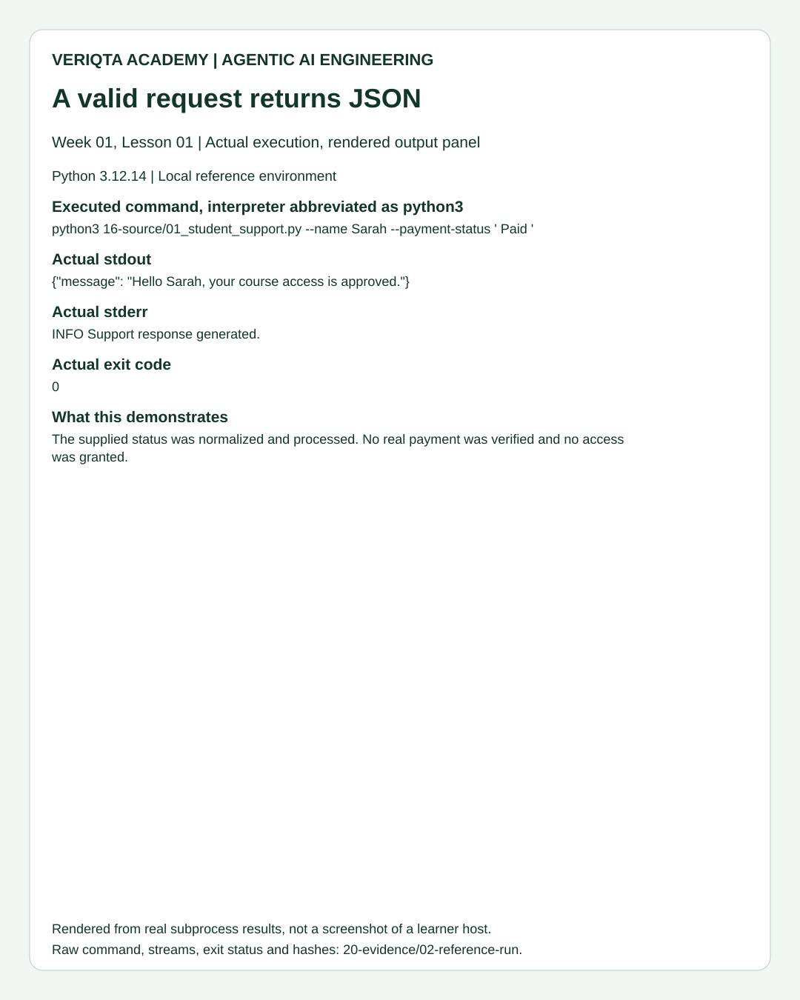
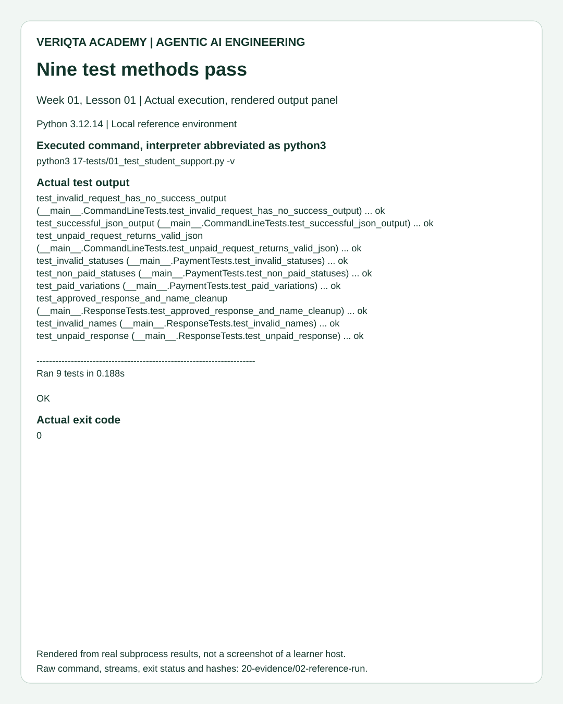
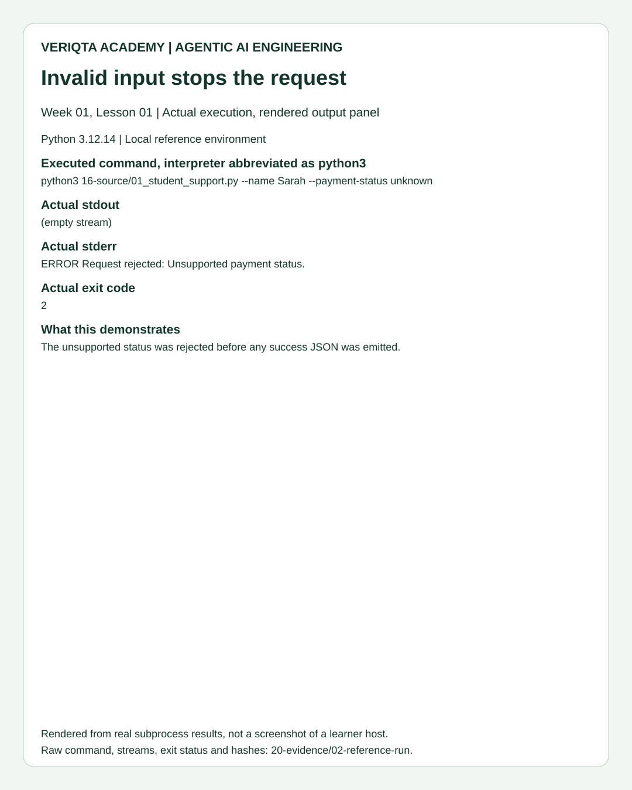
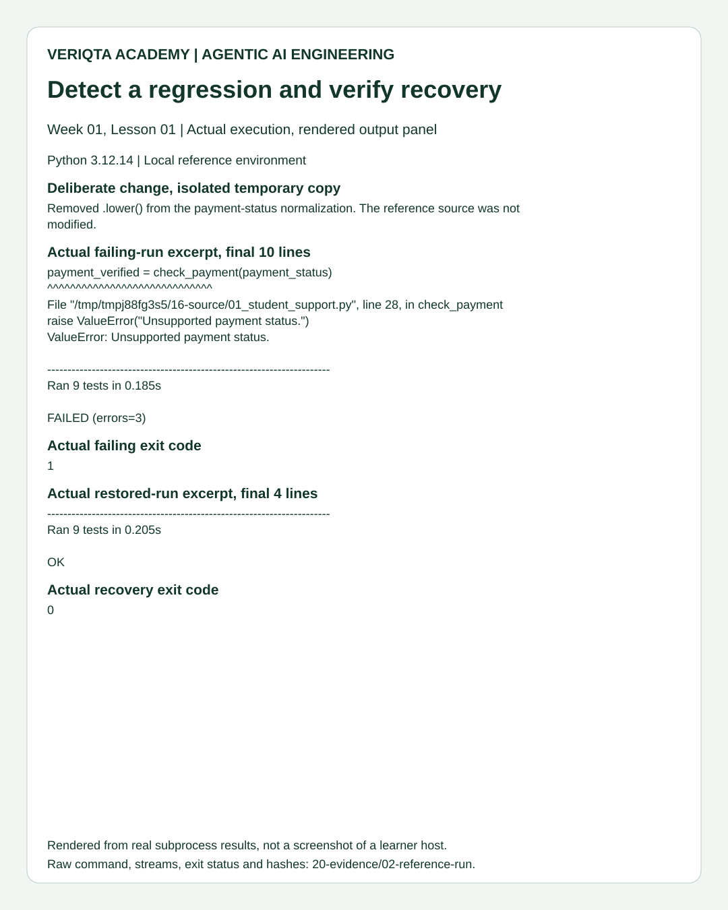

# 19. Visual Reference Index

These images are reproducible rendered panels displaying actual publisher subprocess output. They are clearly labeled rendered execution captures. They are not photographs of a terminal, screenshots of a learner's remote host, or AI-generated evidence. The corresponding raw JSON records are available in [20-evidence](../20-evidence/00-README.md).

| Image | What it demonstrates | Raw source |
|---|---|---|
| [01, successful response](01-success-output.svg) | Actual normalized CLI response, streams and exit code | [03-success.json](../20-evidence/02-reference-run/03-success.json) |
| [02, automated suite](02-test-suite.svg) | Actual nine-method suite output | [04-tests.json](../20-evidence/02-reference-run/04-tests.json) |
| [03, invalid request](03-invalid-input.svg) | Actual error, empty stdout and exit 2 | [05-invalid.json](../20-evidence/02-reference-run/05-invalid.json) |
| [04, regression and recovery](04-regression-recovery.svg) | Actual failing edited copy followed by restored passing tests | [06-regression.json](../20-evidence/02-reference-run/06-regression.json), [07-recovery.json](../20-evidence/02-reference-run/07-recovery.json) |

All panels use 1080 by 1350 portrait format. Long lines are wrapped for readability; original stdout/stderr remains unchanged in the raw records. No displayed test outcome is fabricated. Rendering is presentation, not another application run.

## Comparison gallery

## Reproduce the panels

Run `python3 20-evidence/03_render_output_panels.py` from the lesson directory after generating the reference-run records. This standard-library renderer reads existing results and creates SVG panels using Arial typography. It does not invent results or run the application. It expects the documented 02-reference-run directory and replaces the four reference SVG files. Use a separate working copy when experimenting with presentation.
