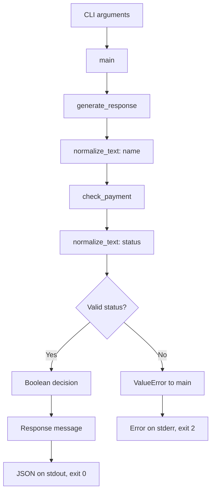

# Instructor Notes

## Start with the support desk

Sarah contacts VERIQTA Academy about course access. A receptionist checks the request, a payment desk interprets its status, and a support representative prepares a response. These responsibilities map to input validation, a business rule and response generation. There is no graphical form in this application: the terminal supplies the values. The form is an analogy for understanding the data.

The original script checked one fixed value and printed a message. The new version accepts arguments, returns reusable values and tests expected and invalid cases automatically. This progression introduces engineering responsibilities without requiring a model API or framework.

## Functions and data

A function is a reusable piece of work. Parameters are names for incoming values. Arguments are the values supplied in a particular call. In `normalize_text("  Sarah  ", "student_name")`, the first argument enters the function as `value`; the second enters as `field_name`. The field label is ordinary text for error messages, not a lookup of a variable.

Local variables belong to a function call. `cleaned` holds the trimmed string inside `normalize_text`; `name` holds its returned result inside `generate_response`. These names can differ because the returned value is what connects the calls.

`return` sends a value back and ends the current function call. `print` writes a representation to the output stream. Returning messages lets tests and future APIs reuse the function without capturing terminal output.

## Validation and normalization

Validate type before calling string methods. `None` and integers are not strings. Raising a deliberate `ValueError` provides a predictable invalid-input contract instead of accidentally failing at `.strip()`.

`strip()` removes whitespace at the beginning and end. It preserves internal spaces and returns a string result; it does not change the original string in place. After trimming, reject empty strings, including input that originally contained only spaces. These checks ensure nonempty text, not verified identity or universal sanitization.

Names preserve capitalization. Payment labels are lowercased because the application deliberately treats `Paid`, `PAID` and `paid` as equivalent. That is a business-contract choice. Do not automatically normalize case-sensitive identifiers or authentication secrets.

## Recognized is different from approved

The recognized statuses are paid, unpaid, pending and refunded. Only paid produces True. Other recognized statuses produce False. Unsupported text raises ValueError. An unpaid request is processed successfully even though access is not approved; an unknown status cannot be interpreted under the contract.

The approval wording is a simulation. A real service must obtain an authenticated, authorized payment record matched to the student, course, amount, currency and transaction state. Neither a user-supplied flag nor a model reading a receipt establishes those facts. Future integrations need their own explicit provider contract and reconciliation behavior.

## Architecture and boundaries

The CLI handles argument parsing and process output. Core functions handle data and decisions without reading files, contacting services or printing. Keeping these responsibilities separate permits reuse, targeted tests and a future API adapter.

Invalid names and non-text or empty statuses also raise ValueError before the status-membership check. Missing CLI arguments are handled directly by argparse.

## Errors, logs and structured output

An exception travels back through callers until an applicable exception handler catches it. The business functions raise ValueError; main logs it and returns 2. Only expected invalid-input exceptions are caught. Unexpected programming errors remain visible for debugging.

Successful processing returns 0. Logs use stderr; JSON uses stdout. Both may appear in the same terminal, but programs can capture them separately. JSON avoids making another program guess how to interpret a human sentence embedded in arbitrary output.

Logging does not include student names or supplied input. The current messages describe success or a controlled validation failure. This is basic observability, not durable audit logging, metrics, tracing or a full production monitoring system.

## AI-assisted review

Before running generated code, identify inputs, side effects, trust assumptions and failure paths. Check imports for unexpected dependencies, inspect subprocess arguments, and verify that invalid input cannot produce success output. Tests should check externally meaningful behavior rather than merely repeat each implementation line.

The test subprocess uses an argument list, with shell execution disabled by default. Input is not interpreted as shell code. This example has no network access, external writes or credentials. Remaining work includes trusted payment integration, resource limits for a public service, authorization, deployment and operational recovery.

## Common misunderstandings

- `=` assigns a value; `==` compares values.
- A successful process exit does not mean the business decision was approval.
- A helper returning False is different from a helper raising an exception.
- Eight or nine passing test methods are not proof of complete input coverage.
- Files called agents in introductory examples do not contain an LLM or an agent execution loop.
- Successful execution does not establish learner understanding, lesson completion or module completion.
